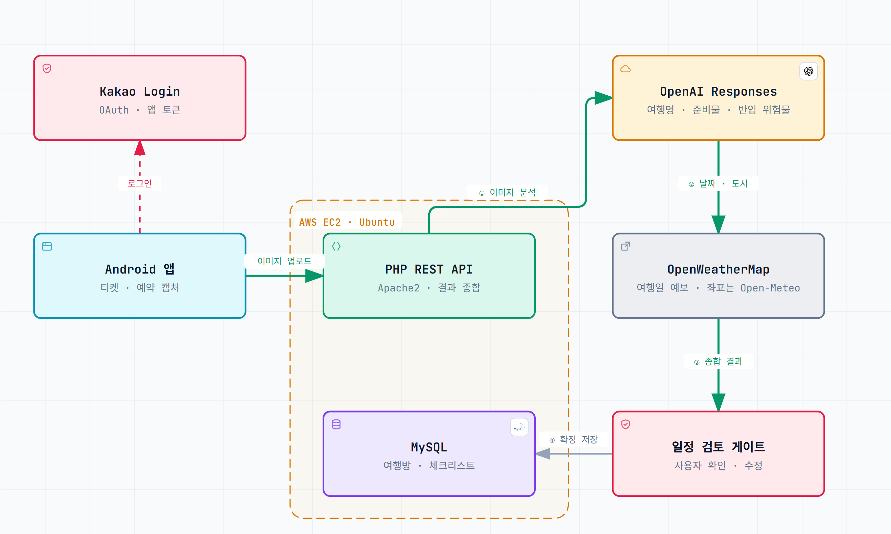

<div align="center">

# 🧳 MyBag 서버

**여행 준비물 앱 「여행가방 대신 싸줘」의 PHP REST API 서버**

<sub>4인 팀 프로젝트 · 서버 1인 담당(팀장) · 2026.08 · 커밋 60개 전부 직접 작성</sub>

<br/><br/>

<a href="https://play.google.com/store/apps/details?id=com.mybagteam.mybag"></a>
<a href="https://github.com/Ju-unn/MyBagHackathon"></a>

<br/><br/>



</div>

<br/>

## 왜 만들었나

여행을 갈 때마다 항공 반입 규정, 준비물, 날씨를 하나씩 찾느라 시간이 많이 들었어요. 그래서 일정 캡처만 올리면 AI가 준비물을 골라 주고 동행자와 나눠 챙기는 앱을 4인 팀으로 만들었습니다.

4명이 데이터를 각자 해석하면 화면마다 결과가 달라져요. 그래서 저는 서버를 맡은 팀장으로 **"앱의 임시 처리보다 서버 데이터가 기준"** 이라는 규칙을 먼저 합의했고, 권한 · 정원 · 데이터 무결성은 모두 서버가 책임지게 만들었어요.

## 어떻게 동작하나

```
요청 → Middleware(인증 · 방 권한 · 요청 수 제한) → Controller → Service → Repository → MySQL
```

캡처를 올리면 서버는 이 순서로 처리해요.

1. **이미지 분석**: OpenAI Responses API가 여행명, 날짜, 도시, 준비물, 반입 위험물을 읽어요.
2. **날씨**: 그 도시와 날짜의 실제 예보를 OpenWeatherMap에서 가져와요(도시 좌표는 Open-Meteo).
3. **일정 검토**: 분석 결과를 앱에 보내고, 사용자가 확인 · 수정할 때까지 저장하지 않아요.
4. **확정 저장**: 확정된 것만 여행방과 체크리스트로 MySQL에 저장해요.

| API 묶음 | 개수 | 하는 일 |
|---|---|---|
| auth | 5 | 카카오 로그인(탈퇴 계정 복구 포함), 로그아웃, 탈퇴(앱 · 웹), 푸시 토큰 등록 |
| trips | 7 | 여행방 만들기 · 목록 · 상세 · 삭제, 초대 코드로 참여, 멤버 보기, 나가기 |
| itinerary | 3 | 캡처 업로드, AI 분석, 일정 확정 |
| checklist | 7 | 준비물 만들기, 목록 · 추가 · 수정 · 삭제, 담당자 지정, 체크 |
| weather | 2 | 여행 기간 예보, 날씨에 맞춘 준비 안내 |
| profile | 6 | 내 기본 물품 4개, 알림 설정 2개 |

## 내가 한 것

서버 전체를 **혼자** 만들었어요. API 30개, 테이블 12개, 예약 작업(cron) 3개예요.

- **같은 체크리스트 보장**: 원래는 고른 물품을 휴대폰 앱 안에서 각자 걸러서, 방장 · 팀원 · 나갔다 다시 들어온 팀원의 목록이 달랐어요. 서버가 **고른 물품만 저장**하게 바꿔 먼저 배포한 뒤 앱의 필터를 지웠어요. 앱을 먼저 바꾸면 그사이 전체 물품이 다시 보이기 때문이에요.
- **서버가 최종 검증**: 방장 권한이 버튼 숨기기로만 막혀 있어서, API를 직접 부르면 통과했어요. 방장이 아니면 서버가 **HTTP 403**으로 거절하게 했어요. 여행방 참여는 방 행을 `FOR UPDATE`로 잠가서, 동시에 들어와도 정원을 넘지 않아요.
- **흔들리던 AI 판정 고정**: 보조배터리, 라이터 같은 반입 위험물 판정이 호출할 때마다 달라졌어요. 항공보안365 공식 안내를 바탕으로 정한 **15개 key(enum) 안에서만** AI가 고르게 하고, 판정 문구는 서버 코드가 채웠어요.
- **AI가 지어낼 수 있는 값은 맡기지 않았어요.** 날씨는 AI 대신 실제 예보로 채우고, 날씨 응답은 `api_cache` 테이블에 캐시해요.
- **예약 작업 3개**: 출발 D-7 · D-3 · D-1 푸시 알림(중복 발송 방지), 방을 만들지 않고 남은 업로드 정리, 탈퇴 30일 뒤 회원 정보 삭제

<br/>

         

## 더 알아보기

- 📐 [폴더 구조와 계층](docs/구조.md)
- 📡 [API 명세 (30개)](APIs.md)
- 🗄️ [DB 스키마 (테이블 12개)](SCHEMA.md)
- 📱 [안드로이드 앱 저장소](https://github.com/Ju-unn/MyBagHackathon)

---

<sub>만든 사람 [@Ju-unn](https://github.com/Ju-unn)</sub>
